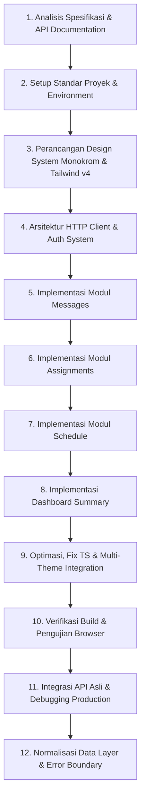

# Riwayat Pengembangan (Development History)
## Frontend Personal Dashboard

Dokumen ini mencatat seluruh riwayat, tahapan pengembangan, keputusan arsitektur, penanganan isu teknis, dan verifikasi akhir dalam pembuatan aplikasi Frontend Personal Dashboard.

---

## 📋 Ringkasan Proyek

- **Nama Proyek:** Frontend Personal Dashboard (Single User)
- **Modul Utama:**
  1. **Messages**: Pesan dari pengunjung website portofolio
  2. **Tugas Kuliah (Assignments)**: Manajemen tugas & status penyelesaian
  3. **Jadwal Pribadi (Schedule)**: Agenda harian/mingguan
  4. **Dashboard**: Ringkasan statistik & aktivitas terkini
  5. **Auth**: Proteksi halaman login & manajemen sesi
- **Target Backend API:** `https://api.appsporto.my.id` (Auth via httpOnly Cookie)
- **Mode Demonstrasi:** Built-in Mock Mode (`VITE_USE_MOCK=true`)

---

## 🛠️ Stack Teknologi

| Kategori | Teknologi / Library | Penggunaan & Catatan |
| :--- | :--- | :--- |
| **Core Framework** | React 18 + Vite + TypeScript | Type-safe strict mode (tanpa `any`) |
| **Styling System** | Tailwind CSS v4 + `@tailwindcss/vite` | Design token khusus & tema Monokrom (B&W) |
| **Routing** | React Router v6 | Layout nesting & `ProtectedRoute` |
| **State & Fetching** | TanStack Query v5 (React Query) | Cache, invalidateQueries, optimistic update |
| **Form & Validasi** | React Hook Form + Zod | Schema validation & error handling |
| **HTTP Client** | Axios | Interceptor 401 & `withCredentials: true` |
| **Date Utility** | `date-fns` (Locale Indonesia `id`) | Format tanggal & perkiraan waktu sisa |
| **Icons** | `lucide-react` | Icon set monokrom murni |

---

## ⏱️ Kronologi Tahapan Pengembangan



### Tahap 1: Analisis Spesifikasi & Dokumentasi API
- Mengunduh & mengekstraksi dokumentasi API resmi backend.
- Mengidentifikasi pola autentikasi: **httpOnly Cookie** (Token JWT tidak disimpan di `localStorage` / `sessionStorage` demi keamanan).
- Mengatur *fallback* & penanganan celah API (API gaps):
  - Endpoint pesan belum mendukung status *read/archive* → dikelola via `localStorage` (*client-side state tracker*).
  - Endpoint `schedule` tidak memiliki metode edit (`PUT`) → disesuaikan hanya mendukung *Create* dan *Delete*.
  - Endpoint tugas kuliah menggunakan penamaan backend: `/api/asignment` (*single 's'*).

---

### Tahap 2: Setup Proyek & Lingkungan Pengembangan
- **Scaffolding**: Inisialisasi Vite + React + TypeScript.
- **Konfigurasi Path Alias**: Menyiapkan `@/` untuk kemudahan impor file.
- **Environment Variables**:
  - `.env` (`VITE_API_BASE_URL` dan `VITE_USE_MOCK=true`).
  - `.env.example` sebagai referensi deployment.

---

### Tahap 3: Design System Monokrom & Tailwind v4
- Mengatur palette warna **Hitam, Putih, dan Grayscale** (tanpa aksen warna seperti merah/hijau/biru murni).
- Membedakan status tugas/prioritas menggunakan **Bentuk Geometris (Shape-based UI)** dan kontras (lingkaran, persegi, garis tepi) agar aksesibel.
- Menyediakan 3 pilihan tema visual:
  - `Light Mode`
  - `Dark Mode`
  - `System Mode` (mengikuti preference OS)
- Membuat komponen UI reusable di `src/components/ui/`:
  - `Button.tsx` (Variant: primary, secondary, outline, ghost, danger)
  - `FormFields.tsx` (Input, Select, Textarea)
  - `Modal.tsx` & `ConfirmDialog.tsx`
  - `Badge.tsx`, `Skeleton.tsx`, `EmptyState.tsx`, `ErrorState.tsx`
  - `ToastContext.tsx` (Notifikasi melayang)

---

### Tahap 4: Client API & Auth System (`src/features/auth`)
- **Axios Client (`src/lib/api/client.ts`)**:
  - Konfigurasi `withCredentials: true` untuk menangani kirim-terima cookie autentikasi secara otomatis.
  - Interceptor global merespon `401 Unauthorized` untuk memicu pembersihan sesi.
- **Mock Service Integration**:
  - Menyediakan *Mock API Handler* penuh saat `VITE_USE_MOCK=true`.
  - Kredensial Mock: `admin` / `admin123`.
- **Auth Provider (`src/features/auth/AuthContext.tsx`)**:
  - Verifikasi sesi saat aplikasi *mount* (`getMeApi`).
  - Proteksi rute halaman via `<ProtectedRoute />`.

---

### Tahap 5: Implementasi Modul Messages (`src/features/messages`)
- Fitur:
  - Inbox pesan dari pengunjung portofolio.
  - Filter pencarian nama/email/subjek pesan.
  - Filter tab (*Semua*, *Belum Dibaca*, *Diarsipkan*).
  - Modal detail pesan & konfirmasi hapus pesan.

---

### Tahap 6: Implementasi Modul Assignments (`src/features/assignments`)
- Fitur:
  - Daftar tugas kuliah dengan indikator *Priority* (High/Medium/Low) dan status (Pending/In Progress/Completed).
  - Form Tambah & Edit Tugas dengan React Hook Form + Zod.
  - Fast-toggle status langsung dari kartu tugas dengan *Optimistic Update* TanStack Query.
  - Indikator tenggat waktu (*Deadline Badge*) & sisa waktu penyelesaian.

---

### Tahap 7: Implementasi Modul Schedule (`src/features/schedule`)
- Fitur:
  - Agenda kegiatan harian & mingguan.
  - Filter hari/kategori kegiatan.
  - Form Tambah Agenda Baru.
  - Konfirmasi Hapus Agenda.

---

### Tahap 8: Implementasi Dashboard Summary (`src/pages/DashboardPage.tsx`)
- Menggabungkan statistik ringkasan dari 3 modul utama:
  - Total pesan masuk & jumlah pesan belum dibaca.
  - Statistik tugas kuliah (Tugas pending & yang mendekati deadline).
  - Agenda kegiatan untuk hari ini.
- Komponen aksi cepat (*Quick Actions*) untuk mempercepat navigasi.

---

### Tahap 9–10: Build, Verifikasi & Pengujian Mock Mode
- `tsc --noEmit` → **0 errors**.
- `npm run build` → Berhasil, 2.971 modul, ~25KB CSS + ~591KB JS.
- Seluruh halaman diuji di browser menggunakan Mock Mode.

---

### Tahap 11: Integrasi API Asli & Debugging

Setelah aplikasi selesai diuji dengan Mock Mode, dilakukan koneksi ke API production (`https://api.appsporto.my.id`).

**Masalah yang Ditemukan:**

#### 11.1 — Cookie Terblokir Browser (SameSite Restriction)
- **Gejala**: Login berhasil (server mengembalikan `200`), namun langsung di-redirect kembali ke halaman login dengan notifikasi "Sesi berakhir".
- **Penyebab**: Cookie autentikasi dari backend menggunakan atribut `SameSite=Lax`. Browser modern memblokir pengiriman cookie lintas-domain — frontend di `localhost:5173` tidak dianggap domain yang sama dengan `api.appsporto.my.id`.
- **Solusi**: Mengkonfigurasi **Vite Dev Server Proxy** (`server.proxy` di `vite.config.ts`). Semua request ke `/api/*` di-tunnel melalui server Vite sendiri, sehingga bagi browser permintaan dianggap berasal dari `localhost`. Cookie pun diterima dan dikirim dengan normal.

```ts
// vite.config.ts — tambahan konfigurasi proxy
server: {
  proxy: {
    '/api': {
      target: 'https://api.appsporto.my.id',
      changeOrigin: true,
    },
  },
},
```

> Nilai `VITE_API_BASE_URL` dikosongkan (`=`) agar Axios menembak ke path relatif `/api/...` (ditangkap proxy), bukan langsung ke domain eksternal.

---

### Tahap 12: Normalisasi Data Layer & Error Boundary

Setelah login berhasil, halaman menampilkan **black screen** (layar hitam penuh).

**Penyebab Root Cause:**

Semua request API (`message`, `asignment`, `schedule`) mengembalikan status `200`, namun struktur response dari API asli sedikit berbeda dari asumsi awal saat Mock Mode dirancang:
- Beberapa field tanggal (`date`, `deadline`) datang dalam format yang tidak sama (misal: ISO penuh `"2024-10-14T00:00:00Z"` alih-alih `"2024-10-14"`).
- Fungsi `date-fns` (`parseISO`, `formatDistanceToNow`) melempar `RangeError: Invalid time value` saat menerima string `null` / format tidak dikenal.
- React tidak menangkap error ini → seluruh tree component di-unmount → layar menjadi hitam.

**Perbaikan yang Diterapkan:**

| File | Perubahan |
| :--- | :--- |
| `src/lib/utils/date.ts` | Semua fungsi (`formatDate`, `formatRelative`, `formatDateTime`, dll.) dibungkus `try-catch`. Nilai `null`/`undefined`/format tidak valid dikembalikan sebagai `'—'` tanpa melempar error. |
| `src/features/messages/api.ts` | Ditambahkan `normalizeMessage()` — memetakan berbagai kemungkinan nama field dari API (`id`, `id_message`, `created_at`, `createdAt`) ke format internal yang konsisten. |
| `src/features/assignments/api.ts` | Ditambahkan `normalizeAssignment()` — menangani `deadline` yang bisa berupa `[date, time]` array, string ISO penuh, atau field terpisah `deadline_date`/`deadline_time`. |
| `src/features/schedule/api.ts` | Ditambahkan `normalizeSchedule()` — menangani `date` ISO dan berbagai nama field alternatif. |
| `src/App.tsx` | Ditambahkan komponen `ErrorBoundary` (class component) yang membungkus setiap halaman. Jika terjadi error render yang tidak tertangkap, ditampilkan pesan error bermakna + tombol "Coba Lagi" alih-alih black screen. |

---

## 🔧 Riwayat Masalah Teknis & Penyelesaian (Troubleshooting Log)

| No | Masalah | Penyebab | Solusi / Perbaikan |
| :--- | :--- | :--- | :--- |
| **1** | File package internal rusak (`picomatch`, `source-map-js`) | Terputusnya proses `npm install` sebelumnya | Pembersihan total `node_modules` + instalasi ulang bersih. |
| **2** | Peringatan TS6 `baseUrl` deprecated | TypeScript v5.5+ merekomendasikan `moduleResolution: bundler` | Menggunakan `ignoreDeprecations: "6.0"` pada `tsconfig.json`. |
| **3** | Impor CSS via path alias (`@/index.css`) gagal di entrypoint | Vite membutuhkan impor relatif untuk CSS global di `main.tsx` | Diubah menjadi `./index.css` (path relatif). |
| **4** | Type explicit React imports error | Konfigurasi strict TypeScript pada JSX transformer | Menambahkan `import type React from 'react'` di komponen UI dasar. |
| **5** | Login berhasil tapi redirect ke `/login` lagi | `SameSite=Lax` cookie diblokir browser saat lintas domain | Konfigurasi **Vite Proxy** → request tunneled via `localhost`. |
| **6** | Black screen setelah berhasil masuk dashboard | `RangeError: Invalid time value` dari `date-fns` saat menerima format tanggal berbeda dari API asli | Rewrite `date.ts` defensive + tambah normalisasi per-feature + `ErrorBoundary` global. |

---

## 🧪 Verifikasi & Pengujian Akhir

1. **TypeScript Type Check**:
   ```bash
   npx tsc --noEmit
   # Hasil: 0 errors
   ```
2. **Production Bundle Build**:
   ```bash
   npm run build
   # Hasil: Transpilasi sukses (2,971 modules, dist/ CSS ~25KB, JS ~591KB)
   ```
3. **Mock Mode**: Login `admin` / `admin123`, semua halaman & modal berfungsi.
4. **Real API Mode**: Login dengan kredensial nyata, semua request `200`, data ditampilkan di dashboard.

---

## 📦 Dokumentasi Terkait

- [`README.md`](file:///e:/fe-dashboard-react/README.md) — Panduan pengoperasian & integrasi API backend real.
